# Coprocessador Gráfico Programável em FPGA
TEC499 - MI SISTEMAS DIGITAIS · Problema 2

*Componentes do grupo:*
* Davi Freitas Queiroz (https://github.com/daviqueirozzcomp)
* Pedro Haywanon Santos Araujo (https://github.com/phaywanon)
* Pedro Kruschewsky Lordelo (https://github.com/pkruschewsky)

*Tutor:* Angelo Amâncio Duarte

*Universidade Estadual de Feira de Santana (UEFS)*

---

## 1. Introdução

No Problema 1, construímos um núcleo gráfico capaz de gerar uma imagem VGA a partir de três camadas: um plano de fundo em *tiles*, sprites móveis e um rasterizador de polígonos. Esse núcleo funcionava, mas cada motor era comandado diretamente pelas chaves e botões da placa, por meio de um decodificador de modos. Em um sistema real, isso não é suficiente: a aplicação não deveria conhecer os detalhes internos de cada módulo gráfico. Ela deveria apenas **enviar comandos**, e caberia ao hardware interpretá-los.

O objetivo deste segundo problema foi justamente dar esse passo: **transformar o núcleo gráfico em um coprocessador programável**. Para isso, projetamos um processador completo dentro da FPGA, com conjunto de instruções próprio (ISA de 32 bits), unidade de busca, registrador de instrução, unidade de controle multiciclo, banco de registradores, ULA, *datapath* e registrador de status. Os motores do Problema 1 passaram a ser **unidades funcionais** desse processador: nada muda na tela se não for consequência da execução de uma instrução.

As instruções são produzidas por programas que rodam no processador ARM da DE1-SoC (o HPS, com Linux) e chegam à FPGA pela ponte *lightweight*, através de três PIOs. Do lado do software, desenvolvemos um **driver em Assembly ARM**, um **menu interativo** para testes, uma **demonstração 100% em Assembly ARM** e um **programa escrito no Assembly da nossa própria ISA**, junto com o montador que o traduz para código de máquina.

Um dos pontos mais trabalhosos do projeto foi a comunicação entre dois mundos que funcionam em ritmos diferentes: o ARM e a FPGA. A primeira versão que levamos para a placa não se comportava como na simulação justamente por causa dessa diferença de clocks — o problema e a solução estão detalhados na seção 4.3.

---

## 2. Especificação de Hardware

| Item | Valor |
|---|---|
| Placa de desenvolvimento | Terasic DE1-SoC |
| FPGA | Intel/Altera Cyclone V SoC — `5CSEMA5F31C6` |
| Processador do sistema | HPS: ARM Cortex-A9, executando Linux |
| Ferramenta de síntese | Quartus Prime 25.1std.0 Build 1129 (SC Lite Edition) + Platform Designer |
| Simulação | Icarus Verilog (`iverilog` / `vvp`) |
| Clock de entrada | 50 MHz (`CLOCK_50`), dividido internamente para 25 MHz (`clk25`) |
| Comunicação ARM–FPGA | ponte *lightweight* HPS-to-FPGA em `0xFF200000`, com 3 PIOs |
| Periféricos usados | saída VGA (`VGA_R/G/B`, `VGA_HS/VS`, `VGA_CLK`, `VGA_SYNC_N`, `VGA_BLANK_N`), `KEY[0]` (reset), `SW[0]`, `LEDR[9:0]`, `HEX5..HEX0` |

---

## 3. Fundamentação teórica

Para transformar o núcleo gráfico em um processador, foi preciso estudar como os processadores são organizados internamente. A principal referência foi o livro *Computer Organization and Design*, de Patterson e Hennessy, cujo processador MIPS inspirou várias das nossas escolhas.

### 3.1. Do núcleo gráfico ao coprocessador programável

Um **processador** é um circuito que lê instruções e as executa, uma após a outra. Cada instrução é apenas um número binário: alguns bits dizem *o que* fazer (o **opcode**) e outros dizem *com quais valores* (registradores, números imediatos). Um **coprocessador** é um processador auxiliar, especializado em uma tarefa — no nosso caso, gráficos —, que trabalha em conjunto com o processador principal. É o mesmo papel que uma placa de vídeo desempenha em um computador: a CPU apenas diz "mova o personagem para (100, 50)", e o coprocessador cuida de todo o resto.

### 3.2. ISA — Instruction Set Architecture

A ISA é o "contrato" entre software e hardware: define quais instruções existem e como cada uma é codificada em bits. Como ela foi criada pela própria equipe, também precisamos definir a sua sintaxe em Assembly e construir um montador que a traduza para código de máquina. Seguimos o estilo *load/store* do MIPS: as instruções gráficas recebem **registradores**, e não números diretos. Assim, a ULA do coprocessador pode calcular posições (por exemplo, `ADD r10, r10, r12` para andar um passo) sem que o ARM precise enviar cada valor.

### 3.3. Busca de instruções: síncrona (passiva) e assíncrona (ativa)

A forma como as instruções chegam à unidade de controle define o tipo de busca:

* **Busca síncrona (passiva):** a instrução fica em um único registrador. O ARM só pode enviar a próxima quando o coprocessador terminar a atual, então os dois ficam presos ao mesmo ritmo.
* **Busca assíncrona (ativa):** existe uma **fila** (FIFO) entre o ARM e a unidade de controle. O ARM escreve no seu próprio ritmo e a unidade de controle **pede** a próxima instrução sempre que termina a anterior. Os dois lados ficam desacoplados.

Adotamos a **busca assíncrona**, com uma FIFO de 32 posições. Essa escolha é o que permite, por exemplo, que o ARM adiante várias instruções enquanto o coprocessador está parado esperando o próximo quadro de vídeo.

### 3.4. Unidade de controle multiciclo

Patterson e Hennessy descrevem três formas de executar instruções: **monociclo** (tudo em um único ciclo longo), **multiciclo** (cada instrução dividida em etapas, uma por ciclo) e **pipeline** (etapas de instruções diferentes sobrepostas). Escolhemos a abordagem **multiciclo**: cada instrução passa por busca, decodificação e execução, uma etapa por ciclo. Ela permite reaproveitar uma única ULA várias vezes dentro da mesma instrução e, por não sobrepor instruções, elimina os *hazards* de dados e de controle típicos de um pipeline.

### 3.5. Comunicação HPS–FPGA: MMIO, PIOs e ponte lightweight

O ARM e a FPGA estão no mesmo chip, ligados por barramentos chamados **pontes**. Usamos a ponte *lightweight*, que aparece para o ARM no endereço físico `0xFF200000`. Nela, criamos no Platform Designer três **PIOs** (*Parallel I/O*): registradores de 32 bits que, de um lado, são endereços de memória para o ARM e, do outro, viram fios dentro da FPGA. Esse esquema se chama **MMIO** (*memory-mapped I/O*): para o programa, escrever no hardware é o mesmo que escrever em uma posição de memória. No Linux, o acesso é feito abrindo `/dev/mem` e mapeando a região da ponte com `mmap`.

### 3.6. Domínios de clock e metaestabilidade

Quando um sinal é gerado por um circuito com um clock e lido por outro circuito com um clock diferente, ele está **cruzando domínios de clock**. Se o sinal mudar exatamente no instante da borda do clock de quem o lê, o flip-flop pode entrar em um estado intermediário, nem 0 nem 1, por um tempo imprevisível: é a **metaestabilidade**. A técnica clássica para evitar o problema é o **sincronizador de dois flip-flops**: o primeiro absorve a possível indecisão e o segundo entrega um valor já estável ao resto do circuito. Para dados com vários bits, o sincronizador não basta, e é preciso um **protocolo de handshake** que garanta que o dado só seja lido quando estiver estável.

### 3.7. Sincronização com o vídeo e *tearing*

O monitor desenha a imagem linha por linha, de cima para baixo, 60 vezes por segundo. Entre o fim de uma tela e o começo da próxima existe um intervalo invisível chamado **vblank** (*vertical blanking*). Se a posição de um sprite mudar no meio do desenho, a parte de cima da tela mostra o sprite no lugar antigo e a de baixo no novo: a imagem aparece "rasgada" (*tearing*). Sistemas com *framebuffer* resolvem isso com troca de buffers; no nosso projeto, que não usa *framebuffer*, a solução é fazer as alterações exatamente durante o vblank.

---

## 4. Arquitetura e Datapath

### 4.1. Visão geral

A arquitetura segue o caminho de uma instrução, desde o programa no ARM até o pixel no monitor:

<p align="center">
  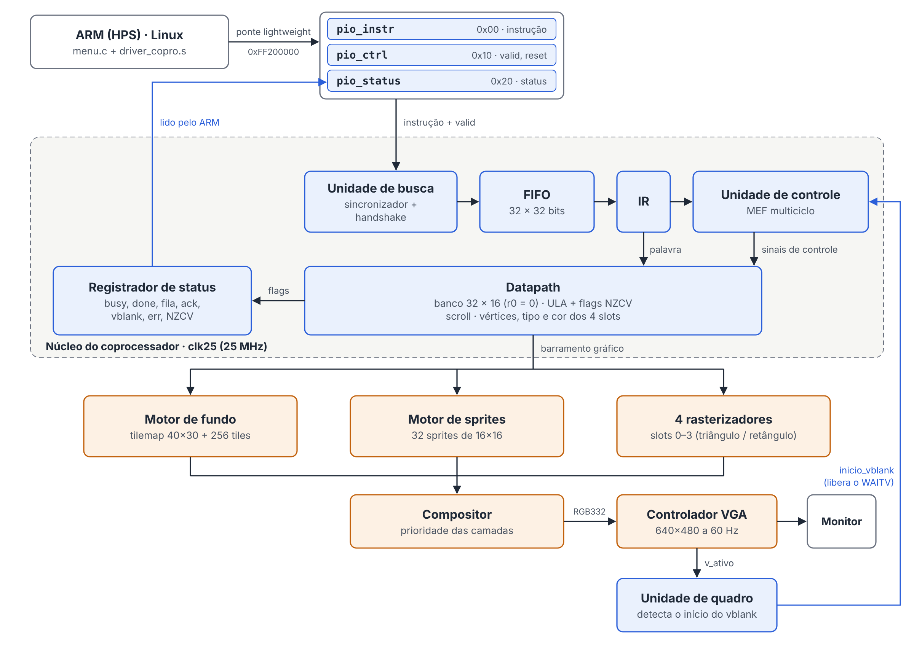
</p>
<p align="center"><em>Figura 1 – Diagrama de blocos do sistema: do programa no ARM até o pixel no monitor.</em></p>

| Módulo | Arquivo | Função |
|---|---|---|
| Topo da placa | `quartus/ghrd_top.v` | HPS, os 3 PIOs, o coprocessador e o painel de depuração |
| Topo do coprocessador | `rtl/coprocessador_top.v` | clock de 25 MHz, reset, núcleo, motores, compositor e VGA |
| Núcleo programável | `rtl/nucleo_coprocessador.v` | busca + unidade de controle + datapath + registrador de status |
| Unidade de busca | `rtl/unidade_busca.v`, `rtl/fifo_instr.v` | handshake com o ARM, FIFO de 32 posições e IR |
| Unidade de controle | `rtl/unidade_controle.v` | máquina de estados multiciclo |
| Datapath | `rtl/caminho_dados.v`, `rtl/banco_registradores.v`, `rtl/ula.v` | registradores, ULA, flags e registradores das unidades gráficas |
| Unidade de quadro | `rtl/unidade_quadro.v` | detecta o início do vblank e libera o `WAITV` |
| Restauração do fundo | `rtl/restaura_tilemap.v` | devolve o mapa inicial à RAM do tilemap a cada reset |
| Unidades gráficas | `rtl/motor_sprites.v`, `rtl/compositor.v`, `rtl/fase1/*` | fundo, sprites, polígonos e composição |
| Controlador VGA | `rtl/vga_driver.v` | varredura 640×480 a 60 Hz |
| Painel de depuração | `rtl/painel_depuracao.v` | status nos LEDs e instrução atual nos displays |

### 4.2. Interface MMIO e handshake de 4 fases

Os três PIOs criados no Platform Designer formam toda a interface entre o ARM e o coprocessador:

| PIO | Endereço | Direção | Conteúdo |
|---|---|---|---|
| `pio_instr` | `0xFF200000` | ARM → FPGA | a instrução de 32 bits |
| `pio_ctrl` | `0xFF200010` | ARM → FPGA | bit 0 = `valid` (há instrução nova), bit 1 = reset do coprocessador |
| `pio_status` | `0xFF200020` | FPGA → ARM | registrador de status (seção 4.7) |

A entrega de cada instrução segue um **handshake de 4 fases**, implementado no driver (`copro_envia`) e na unidade de busca:

1. O ARM espera a fila **não estar cheia** e o `ack` estar em 0.
2. O ARM escreve a instrução no `pio_instr` e, em seguida, sobe o `valid`.
3. A unidade de busca grava a instrução na FIFO e sobe o `ack`. O ARM espera ver `ack = 1`.
4. O ARM baixa o `valid`; a unidade de busca percebe e baixa o `ack`. Só então uma nova instrução pode ser enviada.

<p align="center">
  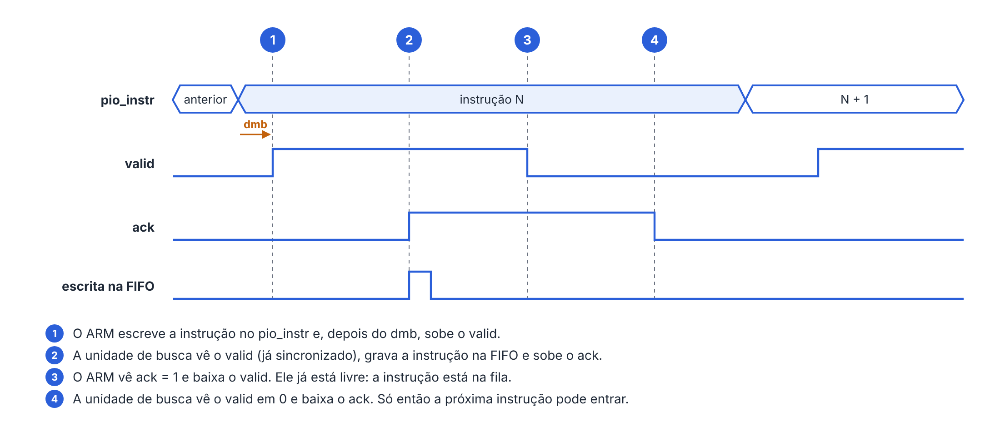
</p>
<p align="center"><em>Figura 2 – Formas de onda do handshake de 4 fases para o envio de uma instrução.</em></p>

O ponto central da busca assíncrona está na fase 3: o `ack` confirma que a instrução **entrou na fila**, e não que ela foi executada. Por isso o ARM fica livre logo em seguida e só é obrigado a esperar quando a fila está cheia.

### 4.3. Sincronização entre o clock do ARM e o clock da FPGA

Este foi o problema que mais nos custou tempo na placa e merece ser contado com calma.

**Os três ritmos do sistema.** O ARM roda a centenas de megahertz. Quando ele escreve nos PIOs, a escrita atravessa a ponte e chega a registradores que funcionam com o clock do sistema do Platform Designer, de **50 MHz**. Já o núcleo do coprocessador e todo o vídeo funcionam com o **clock de 25 MHz** (`clk25`), gerado a partir do `CLOCK_50`. Ou seja: o sinal `valid` e a palavra da instrução nascem em um domínio de clock (50 MHz) e são usados em outro (25 MHz), sem nenhuma relação de fase garantida entre as bordas dos dois.

**O que acontecia.** Na simulação, com os clocks bem comportados, tudo funcionava. Na placa, porém, a primeira versão não se comportava da mesma forma: as instruções nem sempre eram recebidas corretamente — algumas se perdiam, outras eram lidas mais de uma vez — e o resultado variava de uma execução para outra. O motivo era justamente a diferença de clocks: o `valid` vindo do domínio de 50 MHz era lido diretamente pela lógica de 25 MHz. Quando ele mudava perto da borda do `clk25`, o circuito podia enxergar o sinal em momentos diferentes (ou até ficar metaestável), e a captura da palavra não era confiável. Além disso, não havia uma confirmação que garantisse ao ARM que a palavra realmente tinha sido guardada antes de ele enviar a próxima.

**Como resolvemos.** A correção combinou medidas no hardware, no software e nas restrições de timing:

* **Sincronizador de 2 flip-flops no `valid`** (`unidade_busca.v`): o `valid` passa por dois registradores no domínio de 25 MHz (`valid_s1` → `valid_s2`) antes de ser usado. Somente o `valid_s2`, já estável, entra na lógica do handshake.
* **Handshake de 4 fases com `ack` registrado:** a unidade de busca é uma pequena máquina de dois estados (`ESPERA_VALID` e `ESPERA_BAIXAR`). Ela só grava a palavra na FIFO quando vê o `valid` sincronizado em 1 e há espaço na fila, e só aceita uma nova palavra depois que o ARM baixa o `valid`. Assim, cada instrução entra **exatamente uma vez**.
* **Sincronizar só o controle, não os dados:** a palavra de 32 bits não passa por sincronizador. Isso é seguro porque o protocolo garante que ela é escrita **antes** do `valid` subir e permanece parada até o `ack`. Quando o `valid` sincronizado é visto, a palavra já está estável há vários ciclos.
* **Ordem das escritas no driver:** no `copro_envia`, entre a escrita da instrução e a escrita do `valid`, usamos a instrução `dmb` (*data memory barrier*) do ARM. Ela garante que a instrução chegue ao PIO antes do `valid`, impedindo que o processador ou o barramento reordenem as duas escritas.
* **Reset sincronizado:** o reset, que pode vir do botão `KEY[0]` ou do bit 1 do `pio_ctrl`, também passa por dois flip-flops no domínio de 25 MHz.
* **Restrição de timing para o `clk25`:** declaramos o clock dividido no arquivo `soc_system_timing.sdc` (`create_generated_clock`), para que o analisador de timing do Quartus conheça o domínio de 25 MHz e verifique corretamente todos os caminhos.

<p align="center">
  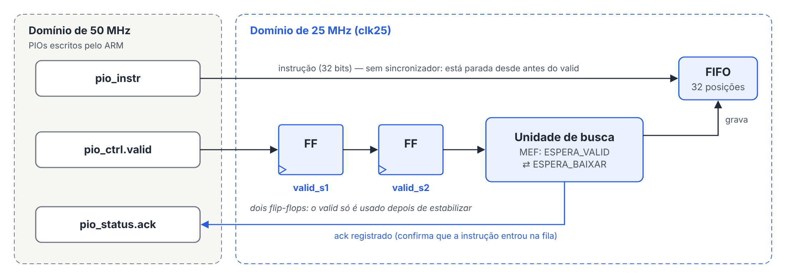
</p>
<p align="center"><em>Figura 3 – Travessia entre os domínios de clock: só o <code>valid</code> passa pelo sincronizador; a palavra da instrução já está estável quando é gravada.</em></p>

Depois dessas mudanças, a comunicação passou a funcionar de forma estável na placa. Para garantir que o problema não voltasse, o testbench da unidade de busca (`tb_unidade_busca.v`) simula o "ARM" com um clock próprio de 50 MHz, com fase deslocada em relação ao de 25 MHz, e confere se nenhuma instrução é perdida ou duplicada. O driver também tem um limite de espera: se a FPGA não responder (por exemplo, se não estiver programada), ele desiste após alguns segundos e informa o status, em vez de travar.

### 4.4. Unidade de busca, FIFO e registrador de instrução

A FIFO (`fifo_instr.v`) tem 32 posições de 32 bits e funciona como um *buffer* circular com dois ponteiros: a escrita grava onde aponta o ponteiro de escrita e avança; a leitura entrega a posição apontada pelo ponteiro de leitura e avança quando a unidade de controle pede. Como os dois ponteiros andam no mesmo sentido, a primeira instrução a entrar é a primeira a sair.

Os ponteiros têm **um bit a mais** do que o necessário para endereçar 32 posições. Sem esse bit, a fila cheia e a fila vazia seriam indistinguíveis, porque nos dois casos os endereços seriam iguais. Com ele, a fila está vazia quando os ponteiros são totalmente iguais e cheia quando os endereços coincidem mas o bit extra é diferente. A diferença entre os ponteiros é a quantidade de instruções na fila, informada ao ARM no registrador de status.

O registrador de instrução (IR) fica dentro da unidade de busca. Quando a unidade de controle dá o pulso de `busca`, na mesma borda de clock a instrução da frente sai da FIFO e é copiada para o IR. O conteúdo do IR segue para a unidade de controle (apenas o opcode) e para o datapath (a palavra inteira).

### 4.5. Unidade de controle multiciclo

A unidade de controle (`unidade_controle.v`) é uma máquina de estados que não calcula nada: ela apenas liga, a cada ciclo, os sinais que dizem ao datapath o que fazer, no estilo dos sinais `RegWrite`, `ALUSrc` e `ALUOp` do Patterson.

<p align="center">
  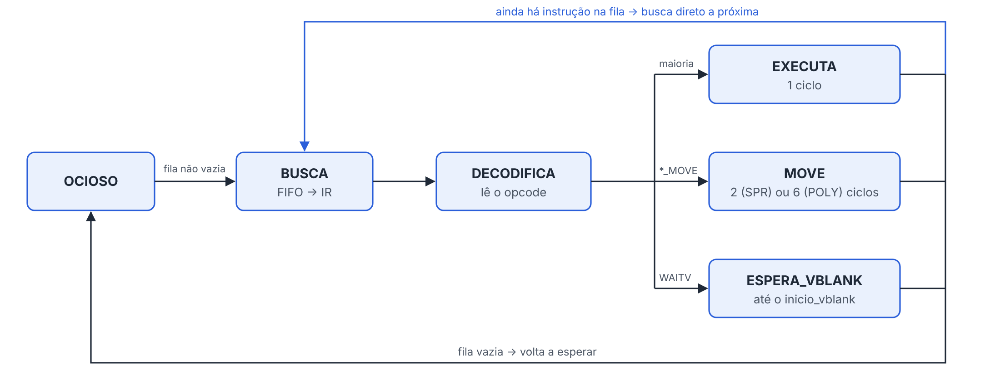
</p>
<p align="center"><em>Figura 4 – Máquina de estados da unidade de controle.</em></p>

| Instrução | Etapas | Ciclos |
|---|---|---|
| a maioria | BUSCA → DECODIFICA → EXECUTA | 3 (120 ns a 25 MHz) |
| `SPR_MOVE` | BUSCA → DECODIFICA → MOVE ×2 | 4 |
| `POLY_MOVE` | BUSCA → DECODIFICA → MOVE ×6 | 8 |
| `WAITV` | BUSCA → DECODIFICA → ESPERA_VBLANK | 2 + a espera pelo vblank |

As instruções de movimento levam mais ciclos porque existe uma única ULA: o `SPR_MOVE` soma x e y, uma coordenada por ciclo, e o `POLY_MOVE` soma x e y nos três vértices. Ao final de qualquer instrução, se ainda houver algo na fila, a unidade volta direto para BUSCA, sem desperdiçar ciclos. Um opcode inválido é tratado como `NOP` e liga o bit `err` do status, que permanece em 1 até o próximo reset.

A ISA não possui instruções de desvio. Isso foi intencional: como as instruções chegam por uma fila, e não de uma memória com endereços, não existe para onde "pular". O controle de fluxo (laços e decisões) fica no programa do ARM, que escolhe quais blocos de instruções enviar e quando.

### 4.6. Datapath: banco de registradores, ULA e flags

* **Banco de registradores** (`banco_registradores.v`): 32 registradores de 16 bits, com duas portas de leitura combinacionais e uma de escrita síncrona. O `r0` vale sempre zero, como no MIPS. São 32 registradores porque os campos de registrador da instrução têm 5 bits; e 16 bits porque as coordenadas precisam de 9 bits e ainda sobra espaço para passos negativos em complemento de dois.
* **ULA** (`ula.v`): soma, subtração, E e OU de 16 bits, gerando as flags **N** (negativo), **Z** (zero), **C** (*carry*; na subtração, 1 indica que não houve empréstimo) e **V** (*overflow* com sinal). As operações lógicas atualizam apenas N e Z.
* **Multiplexadores:** a unidade de controle escolhe as entradas da ULA (registradores, imediato ou a coordenada atual de um sprite/vértice nos `MOVE`) e o que é escrito no banco (resultado da ULA ou imediato do `LI`).
* **Registradores das unidades gráficas:** o scroll e os vértices, tipo e cor dos 4 slots de polígono ficam no próprio datapath. O número do slot vem do campo A da instrução.

### 4.7. Registrador de status

É a única janela que o ARM tem para dentro do coprocessador. Ele é montado em `nucleo_coprocessador.v` a partir de sinais de vários módulos:

| Bits | Campo | Origem |
|---|---|---|
| 0 | busy | unidade de controle fora do estado ocioso (ou restauração do fundo em andamento) |
| 1 | done | fila vazia **e** unidade de controle parada |
| 2 / 3 | fila cheia / fila vazia | FIFO |
| 4 | ack | unidade de busca |
| 5 | vblank | unidade de quadro |
| 6 | err | opcode inválido recebido (permanece até o reset) |
| 11:8 | flags N Z C V | ULA |
| 21:16 | instruções na fila (0 a 32) | FIFO |

### 4.8. Unidade de quadro e a instrução `WAITV`

A unidade de quadro (`unidade_quadro.v`) observa o sinal `v_ativo` do controlador VGA, que vale 1 enquanto as 480 linhas visíveis estão sendo desenhadas. Comparando o valor atual com o do ciclo anterior, ela detecta o instante exato em que a área visível termina e gera um pulso de um ciclo, o `inicio_vblank`. Esse pulso vai para a unidade de controle.

Quando o programa envia um `WAITV`, a unidade de controle entra no estado `ESPERA_VBLANK` e permanece nele até o pulso chegar. Tudo o que vem depois do `WAITV` é executado no tempo invisível, então cada tela é desenhada inteira com o estado novo, sem rasgos. O `WAITV` não é automático: o programa o envia quando precisa. Nas animações, cada quadro começa com um `WAITV`, o que também dá o ritmo de 60 passos por segundo. Enquanto a unidade de controle espera, o ARM continua enviando instruções, que se acumulam na fila — é exatamente esse comportamento que a opção 6 do menu demonstra.

### 4.9. Restauração do mapa no reset

O reset zera os registradores (sprites, polígonos e scroll), mas a RAM do tilemap só recebe o mapa original quando a FPGA é programada. Sem tratamento, os tiles trocados com `SET_TILE` continuariam na tela depois do reset. Para resolver isso, guardamos uma cópia do mapa inicial em uma ROM e criamos o módulo `restaura_tilemap.v`: a cada reset, ele copia as 1.200 posições da ROM para a RAM, uma por ciclo (cerca de 48 µs). Durante a cópia, o núcleo fica em reset e o bit `busy` permanece em 1, para que nenhuma instrução escreva no tilemap ao mesmo tempo.

### 4.10. Painel de depuração

Para facilitar os testes na placa, os LEDs mostram o status (`LEDR0` busy, `LEDR1` done, `LEDR2` fila cheia, `LEDR3` fila vazia, `LEDR4` ack, `LEDR5` vblank, `LEDR6` err, `LEDR9..7` flags N Z C) e os displays `HEX5..HEX0` mostram a instrução que está no IR. A chave `SW[0]` alterna qual metade da instrução aparece.

---

## 5. Conjunto de Instruções (ISA)

Todas as instruções têm 32 bits, no formato:

```
 31      27 26     22 21     17 16     12 11                 0
┌──────────┬─────────┬─────────┬─────────┬────────────────────┐
│  opcode  │    A    │    B    │    C    │   bits baixos      │
└──────────┴─────────┴─────────┴─────────┴────────────────────┘
```

O campo A é o destino (registrador, slot, sprite ou linha do tilemap); B e C são os registradores de origem. No `LI` e no `ADDI`, o imediato ocupa os 16 bits de baixo.

| Opcode | Instrução | Efeito |
|---|---|---|
| 0 | `NOP` | nada |
| 1 | `LI rd, imm` | rd ← imm |
| 2 / 3 | `ADD` / `SUB rd, rs, rt` | rd ← rs ± rt, atualiza N Z C V |
| 4 | `ADDI rd, rs, imm` | rd ← rs + imm |
| 5 / 6 | `AND` / `OR rd, rs, rt` | operação lógica, atualiza N e Z |
| 7 | `WAITV` | espera o início do vblank |
| 8 | `SET_TILE lin, col, tile` | troca o tile de uma posição do fundo |
| 9 | `SET_SCROLL rs, rt` | desloca o fundo para (rs, rt) |
| 16 | `POLY_VTX slot, v, rs, rt` | define o vértice v de um slot |
| 17 | `POLY_CFG slot, tipo, cor` | liga o slot como triângulo ou retângulo (ou desliga) e define a cor |
| 18 | `POLY_MOVE slot, rs, rt` | soma (rs, rt) aos três vértices |
| 24 | `SPR_POS n, rs, rt` | posiciona o sprite n |
| 25 | `SPR_ATTR n, tile, flags` | desenho e flags EN, FX, FY e BACK |
| 26 | `SPR_MOVE n, rs, rt` | move o sprite n a partir da posição atual |

Os opcodes foram agrupados em **famílias de 8**, pelos dois bits mais altos: `00xxx` para CPU, `01xxx` para o fundo, `10xxx` para polígonos e `11xxx` para sprites. Isso facilita a leitura e deixa espaço para novas instruções em cada família. O opcode 10 está reservado para um futuro `SET_PAL`.

**Exemplo de codificação:** `ADD r10, r10, r12` → `00010 01010 01010 01100 000000000000` = `0x1294C000`.

---

## 6. Unidades Gráficas

As três camadas do Problema 1 foram mantidas, agora comandadas pela ISA. A principal característica da arquitetura continua sendo a **renderização *on-the-fly***: não há *framebuffer*. Quando o controlador VGA vai desenhar um pixel, os motores calculam naquele instante a cor de cada camada, e o compositor escolhe a que aparece — como faziam os consoles de 16 bits que inspiraram o projeto.

### 6.1. Controlador VGA e resolução lógica

O `vga_driver.v` gera a varredura 640×480 a 60 Hz com o clock de 25 MHz: 800 pontos por linha (640 visíveis + 16 de *front porch* + 96 de pulso `hsync` + 48 de *back porch*) e 525 linhas por quadro (480 + 10 + 2 + 33). A resolução lógica é 320×240: os motores descartam o bit menos significativo das coordenadas do VGA, e cada pixel lógico vira um quadrado de 2×2. Nesta fase, o controlador ganhou a saída `v_ativo`, usada pela unidade de quadro.

### 6.2. Motor de background

Tilemap de 40×30 posições em RAM e 256 tiles de 8×8 em ROM. Para cada pixel, o motor soma o scroll (com repetição ao passar de 320 ou 240), separa o número do tile e a posição dentro dele, consulta a RAM e depois a ROM. O `SET_TILE` escreve na RAM do tilemap (endereço `linha × 40 + coluna`) e o `SET_SCROLL` atualiza o deslocamento. O fundo e os tiles foram redesenhados para esta fase: uma cidade com letreiro, uma fonte com letras e números e tiles avulsos para uso com `SET_TILE`. O catálogo com o número de cada tile está em `ferramentas/fundo/`.

<p align="center">
  
</p>
<p align="center"><em>Figura 5 – Cena inicial do fundo (mapa carregado na RAM do tilemap).</em></p>

### 6.3. Polígonos: 4 slots

Cada **slot** é uma instância completa do rasterizador do Problema 1 (retângulo por comparação direta; triângulo por funções de aresta com aritmética inteira). Os quatro funcionam em paralelo, olhando o mesmo pixel; quando mais de um cobre o pixel, o de menor número fica na frente. Ficamos com 4 slots porque cada rasterizador usa 3 blocos DSP nas multiplicações das funções de aresta; com 12 de 87 DSPs em uso, ainda há espaço para expandir.

### 6.4. Motor de sprites

32 sprites de 16×16 (cada um formado por 4 tiles de 8×8) e 32 desenhos na ROM. Para funcionar com a ISA, o motor passou a receber **escritas por campo** (`SPR_POS` grava só a posição; `SPR_ATTR`, só o desenho e as flags), ganhou uma **porta de leitura** da posição atual, usada pelo `SPR_MOVE`, e o atributo **BACK**, que coloca o sprite atrás dos polígonos. O espelhamento continua sendo feito invertendo a coordenada dentro do sprite (`15 − x`).

<p align="center">
  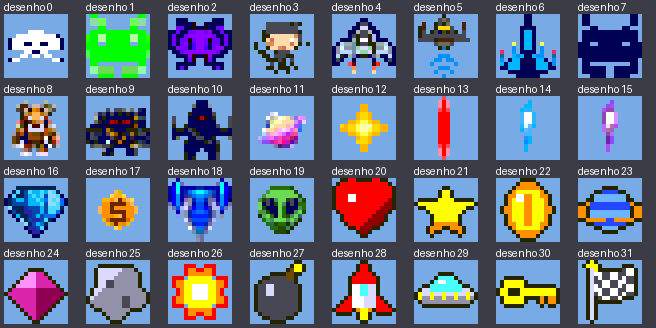
</p>
<p align="center"><em>Figura 6 – Os 32 desenhos da ROM de sprites, escolhidos pelo <code>SPR_ATTR</code>.</em></p>

### 6.5. Compositor e alinhamento das camadas

Prioridade, da mais alta para a mais baixa: **sprite da frente > polígono (slot 0 > 1 > 2 > 3) > sprite com BACK > fundo**. A cor 0 é transparente em sprites e polígonos, e as cores seguem o formato RGB332. Como cada camada tem uma latência diferente (o fundo passa por RAM e ROM; os polígonos são combinacionais), todas são alinhadas para chegar ao compositor com **3 ciclos** de atraso, evitando que pixels de camadas diferentes se desencontrem.

---

## 7. Software

| Arquivo | Descrição |
|---|---|
| `software/driver/driver_copro.s` + `copro.h` | **Driver em Assembly ARM**. Biblioteca sem `main`, único código que acessa os PIOs. Fala com o Linux por chamadas de sistema (`svc`), sem a biblioteca do C, e é independente de posição, funcionando tanto em programas C quanto 100% Assembly. |
| `software/menu/menu.c` | **Menu interativo** para testar o coprocessador sem programar. Mostra cada instrução enviada (mnemônico e hexadecimal) e o status. |
| `software/isa/demo.asm` | **Programa no Assembly da nossa ISA**: cidade com scroll, letreiro, janelas piscando, polígonos e sprites animados. |
| `software/isa/montador.py` | **Montador** da ISA: traduz o `.asm` para código de máquina e gera as tabelas `.word` (`programa_isa.s`) usadas pelo `demo_arm.s`, além de uma listagem (`.lst`) para conferência. |
| `software/arm/demo_arm.s` | **Demonstração 100% em Assembly ARM**: envia os blocos do programa da ISA e decide, a cada quadro, quais enviar. |
| `software/arm/programa_isa.s` | Programa da ISA já traduzido pelo montador, em tabelas `.word` (gerado a partir do `demo.asm`). |
| `software/demo.c` | A mesma demonstração em C, usada como referência. |

O driver oferece funções de baixo nível (`copro_abre`, `copro_envia`, `copro_envia_bloco`, `copro_status`, `copro_reinicia`, `copro_espera_fim`) e de alto nível, que montam as instruções da ISA (`copro_tile`, `copro_scroll`, `copro_vertice`, `copro_poligono`, `copro_sprite_pos`, `copro_sprite_attr`, entre outras).

Como a ISA não tem desvios, o `demo.asm` é dividido em **blocos** (`cena`, `quadro`, `scroll`, `vira_esquerda`...). O ARM, que tem laços e condições, decide quando enviar cada bloco; quem calcula as posições e desenha é o coprocessador.

---

## 8. Recursos, Timing, Desempenho e Limitações

### 8.1. Utilização de recursos da FPGA

Números do relatório de compilação (`quartus/output_files/soc_system.fit.summary`), já incluindo o sistema HPS do projeto de referência:

| Recurso | Utilizado | Disponível | % |
|---|---|---|---|
| ALMs | 4.656 | 32.070 | 15% |
| Registradores | 5.732 | — | — |
| Bits de memória de bloco | 743.168 | 4.065.280 | 18% |
| Blocos de RAM (M10K) | 97 | 397 | 24% |
| Blocos DSP | 12 | 87 | 14% |
| Pinos | 382 | 457 | 84% |

Em relação ao Problema 1, o aumento vem principalmente do processador (FIFO, banco de registradores, unidade de controle, datapath), dos três rasterizadores adicionais (9 DSPs a mais), da ROM do mapa inicial e do próprio sistema HPS com a ponte e os PIOs.

### 8.2. Análise de timing

A **frequência máxima (Fmax)** é o clock mais rápido em que o circuito ainda funciona corretamente. Ela é limitada pelo **caminho crítico**, o trajeto mais lento entre dois registradores: o sinal precisa sair de um registrador, atravessar a lógica combinacional e chegar estável ao próximo antes da borda seguinte do clock. Os valores abaixo foram retirados do Timing Analyzer do Quartus (`quartus/output_files/soc_system.sta.rpt`, seção *Fmax Summary*), no modelo **Slow 1100 mV 85 °C**, que representa o pior caso (chip quente e mais lento).

| Clock | Frequência utilizada | **Fmax** | Setup slack | Hold slack |
|---|---|---|---|---|
| `clk25` (coprocessador e vídeo) | 25 MHz (40 ns) | **49,2 MHz** | +12,891 ns | +0,362 ns |
| `clock_50` | 50 MHz (20 ns) | **91,45 MHz** | +9,065 ns | +0,266 ns |

O *slack* é a sobra de tempo em relação ao clock pedido: positivo significa que o circuito funciona na frequência utilizada. O domínio do coprocessador fecha timing com folga: com Fmax de 49,2 MHz, ele suportaria quase o dobro dos 25 MHz em que opera. (O Quartus calcula a Fmax considerando apenas caminhos dentro do mesmo clock, enquanto o *slack* também inclui os caminhos que cruzam domínios; por isso os dois números não se convertem diretamente um no outro.) Os únicos caminhos com folga negativa no relatório são os da interface de memória **DDR3 do HPS**, que pertence ao projeto de referência da placa e não à lógica desenvolvida pela equipe.

### 8.3. Desempenho

Uma instrução comum leva 3 ciclos, ou 120 ns; cabem mais de 100 mil instruções em um quadro de 16,7 ms. O gargalo, portanto, não é a execução, e sim a comunicação pela ponte e a espera pelo vblank. A FIFO absorve as rajadas: enquanto a unidade de controle aguarda o vblank, o ARM adianta até 32 instruções.

### 8.4. Limitações conhecidas

- A ISA não tem desvios; o controle de fluxo fica no ARM.
- O ARM não consegue ler os registradores do coprocessador, apenas o status. A demonstração mantém uma cópia das posições no ARM para decidir quando mudar de direção.
- Entre sprites sobrepostos, o de menor índice ocupa o quadrado 16×16 inteiro: nas suas partes transparentes aparece a camada de baixo (polígono ou fundo), e não o outro sprite.
- O número de polígonos simultâneos é limitado a 4 (expansível).
- A paleta é fixa (RGB332).

Como melhorias futuras, destacamos instruções de desvio condicional usando as flags que a ULA já gera, uma paleta programável (com o opcode 10 já reservado) e uma forma de o ARM ler os registradores do coprocessador.

---

## 9. Levantamento de Requisitos e Status de Atendimento

Legenda: ✅ Atendido · ⚠️ Parcialmente atendido (justificado) · ❌ Não atendido (justificado)

### 9.1. Arquitetura

- [x] ✅ ISA de 32 bits definida pela equipe (seção 5)
- [x] ✅ Unidade de busca de instruções — busca assíncrona com FIFO de 32 posições (seção 4.4)
- [x] ✅ Registrador de Instrução — IR na unidade de busca
- [x] ✅ Unidade de controle — máquina de estados multiciclo (seção 4.5)
- [x] ✅ Banco de registradores — 32 × 16 bits, `r0 = 0`
- [x] ✅ ULA — ADD, SUB, AND, OR com flags N Z C V
- [x] ✅ Datapath com multiplexadores e registradores das unidades gráficas
- [x] ✅ Registrador de status lido pelo ARM (seção 4.7)
- [x] ✅ Mecanismo de sincronização com VGA — unidade de quadro + `WAITV` (seção 4.8)
- [x] ✅ Motores de background, sprites e polígonos tratados como unidades funcionais
- [x] ✅ Toda operação ocorre como consequência de uma instrução da ISA
- [x] ✅ Compositor, unidade de quadro e controlador VGA operam continuamente, independentes das instruções
- [x] ✅ Mecanismos de comunicação do tipo *valid*, *busy* e *done*

### 9.2. Programa gráfico e software

- [x] ✅ Instruções obtidas de uma fila proveniente da interface MMIO com o ARM
- [x] ✅ Programa em Assembly do ARM que utiliza o coprocessador (`demo_arm.s`), verificado em simulação com o `tb_programa_arm` (seção 11)
- [x] ✅ Programa escrito no Assembly da ISA da equipe, com sintaxe definida (`demo.asm` + `montador.py`)
- [x] ✅ Driver em Assembly ARM como biblioteca separada (`driver_copro.s`)

### 9.3. Verificação e demonstração

- [x] ✅ Testbench para cada módulo principal e testbench de integração (seção 11)
- [x] ✅ Relatório de síntese, utilização de recursos, frequência máxima e análise de timing (seção 8)
- [x] ✅ Demonstração em hardware na DE1-SoC, com o menu interativo (seção 11.2)

### 9.4. Requisitos herdados do Problema 1

- [x] ✅ Saída VGA 640×480 a ~60 Hz, resolução lógica 320×240 com duplicação de pixels
- [x] ✅ Tilemap 40×30, 256 tiles de 8×8, alteração de tiles e scroll com repetição
- [x] ✅ 32 sprites de 16×16 com posição, padrão, habilitação, espelhamentos e prioridade (agora também o atributo BACK)
- [x] ✅ Triângulos e retângulos preenchidos com aritmética inteira (agora em 4 slots)
- [x] ✅ Composição com pelo menos 3 níveis de prioridade (agora 4) e transparência
- [ ] ❌ **Paleta programável de 256 entradas RGB** — não implementada, por orientação do tutor. As cores usam o mapeamento fixo RGB332, e o opcode 10 foi reservado para um futuro `SET_PAL`.

---

## 10. Instruções de Reprodução

### 10.1. Estrutura da entrega

```
PBL2_Coprocessador_Grafico/
├── README.md           este relatório
├── imagens/            figuras do relatório
├── videos/             vídeos da demonstração na placa
├── quartus/            projeto Quartus completo (soc_system.qpf), RTL em quartus/rtl/
│   └── output_files/   soc_system.sof e relatórios de compilação e timing
├── software/
│   ├── driver/         driver em Assembly ARM (driver_copro.s) e seu cabeçalho para C (copro.h)
│   ├── menu/           menu interativo (menu.c)
│   ├── arm/            demonstração em Assembly ARM (demo_arm.s) e o programa da ISA montado
│   ├── isa/            programa no Assembly da ISA (demo.asm) e o montador (montador.py)
│   └── demo.c          a mesma demonstração escrita em C
├── simulacao/
│   ├── tb/             testbenches
│   ├── sim_modelos/    modelos das memórias para simulação e seus conteúdos (.hex)
│   └── resultados_simulacao/   quadros capturados na simulação
└── ferramentas/        catálogos dos tiles e dos sprites e tabela dos tiles avulsos
```

### 10.2. Hardware

1. Copie a pasta para um caminho sem espaços nem acentos.
2. Abra o **Quartus Prime** (25.1 ou compatível com Cyclone V) e, em **File → Open Project**, selecione `quartus/soc_system.qpf`.
3. (Opcional) Em **Platform Designer**, abra `soc_system.qsys` e clique em **Generate HDL** — o HDL gerado já acompanha a entrega em `quartus/soc_system/`.
4. Compile em **Processing → Start Compilation**, ou use diretamente o arquivo `quartus/output_files/soc_system.sof`.
5. Em **Tools → Programmer**, grave o `.sof` no dispositivo `5CSEMA5` e conecte um monitor à saída VGA.

### 10.3. Software (no Linux da placa)

Copie para uma mesma pasta da placa os arquivos de `software/driver/`, `software/menu/menu.c` e `software/arm/`, e compile:

```bash
gcc -o menu menu.c driver_copro.s          # menu interativo
sudo ./menu

as -o demo_arm.o demo_arm.s                # demonstração 100% Assembly
as -o programa_isa.o programa_isa.s
as -o driver_copro.o driver_copro.s
ld -o demo_arm demo_arm.o programa_isa.o driver_copro.o
sudo ./demo_arm 0                          # 0 = anima até Ctrl+C
```

Para alterar o programa da ISA, edite `software/isa/demo.asm` e gere novamente as tabelas no PC com `python3 software/isa/montador.py software/isa/demo.asm -s software/arm/programa_isa.s`.

### 10.4. Simulação

Os testbenches usam o **Icarus Verilog**. Todos os comandos são executados dentro da pasta `simulacao/`. Os testbenches que usam as memórias leem os arquivos `.hex` pelo nome, então eles precisam ser copiados para essa pasta antes:

```bash
cd simulacao
cp sim_modelos/*.hex .
```

Cada testbench é compilado com o seu módulo e executado com `vvp`. Ao final, ele imprime `RESULTADO: TODOS OS TESTES PASSARAM` ou a lista de erros encontrados.

```bash
R=../quartus/rtl

iverilog -o sim tb/tb_fifo_instr.v $R/fifo_instr.v && vvp sim
iverilog -o sim tb/tb_unidade_busca.v $R/unidade_busca.v $R/fifo_instr.v && vvp sim
iverilog -o sim tb/tb_banco_registradores.v $R/banco_registradores.v && vvp sim
iverilog -o sim tb/tb_ula.v $R/ula.v && vvp sim
iverilog -o sim tb/tb_unidade_quadro.v $R/unidade_quadro.v $R/vga_driver.v && vvp sim
iverilog -o sim tb/tb_restaura_tilemap.v $R/restaura_tilemap.v sim_modelos/modelos_memorias.v && vvp sim

NUCLEO="$R/nucleo_coprocessador.v $R/unidade_controle.v $R/caminho_dados.v \
        $R/banco_registradores.v $R/ula.v $R/unidade_busca.v $R/fifo_instr.v"
iverilog -o sim tb/tb_nucleo_coprocessador.v $NUCLEO && vvp sim

TOPO="$R/coprocessador_top.v $R/restaura_tilemap.v $NUCLEO $R/unidade_quadro.v \
      $R/vga_driver.v $R/motor_sprites.v $R/compositor.v $R/fase1/motor_background.v \
      $R/fase1/motor_tilemap.v $R/fase1/motor_tile.v $R/fase1/rom_sprites_inst.v \
      $R/fase1/rasterizador_poligonos.v sim_modelos/modelos_memorias.v"
iverilog -o sim tb/tb_coprocessador_top.v $TOPO && vvp sim     # leva alguns minutos
iverilog -o sim tb/tb_programa_arm.v $TOPO && vvp sim          # leva alguns minutos
```

Os dois últimos testbenches salvam as telas capturadas como imagens `.ppm` (`quadro_N.ppm` e `arm_quadro_N.ppm`) na pasta `simulacao/`. As versões em PNG estão em `simulacao/resultados_simulacao/`.

---

## 11. Verificação Funcional

### 11.1. Testbenches automatizados

Diferente do Problema 1, verificado apenas em bancada, nesta fase cada módulo principal tem um testbench **auto-verificável**: ele mesmo compara o comportamento do circuito com um modelo de referência e imprime `RESULTADO: TODOS OS TESTES PASSARAM` quando não encontra erros.

| Testbench | O que verifica | Resultado |
|---|---|---|
| `tb_fifo_instr` | ordem de saída, fila cheia e vazia, escrita e leitura no mesmo ciclo | 10 testes ✅ |
| `tb_unidade_busca` | handshake de 4 fases com o "ARM" em clock próprio de 50 MHz; nenhuma perda ou duplicação | 8 testes ✅ |
| `tb_banco_registradores` | leitura combinacional, escrita, `r0 = 0`, reset | 7 testes ✅ |
| `tb_ula` | resultados e flags comparados com um modelo independente | 4 testes ✅ |
| `tb_unidade_quadro` | pulso de início do vblank e contagem de quadros, usando o VGA real | 4 testes ✅ |
| `tb_restaura_tilemap` | 1.200 escritas corretas, inclusive com reset no meio da cópia | 3 testes ✅ |
| `tb_nucleo_coprocessador` | cada instrução da ISA, flags, `WAITV` e opcode inválido | 13 testes ✅ |
| `tb_coprocessador_top` | integração completa: captura o quadro VGA e compara **pixel a pixel** com um modelo de referência | 7 testes ✅ |
| `tb_programa_arm` | as palavras realmente enviadas pelo `demo_arm.s`, executadas no RTL e comparadas pixel a pixel | 4 testes ✅ |

Durante o desenvolvimento, também conferimos que os testes de fato detectam falhas: ao introduzir erros de propósito no RTL (por exemplo, desligar a restauração do fundo), os testbenches passaram a acusar diferenças. Os quadros capturados na simulação estão em `simulacao/resultados_simulacao/` e aparecem abaixo, um para cada teste que captura a tela.

<p align="center">
  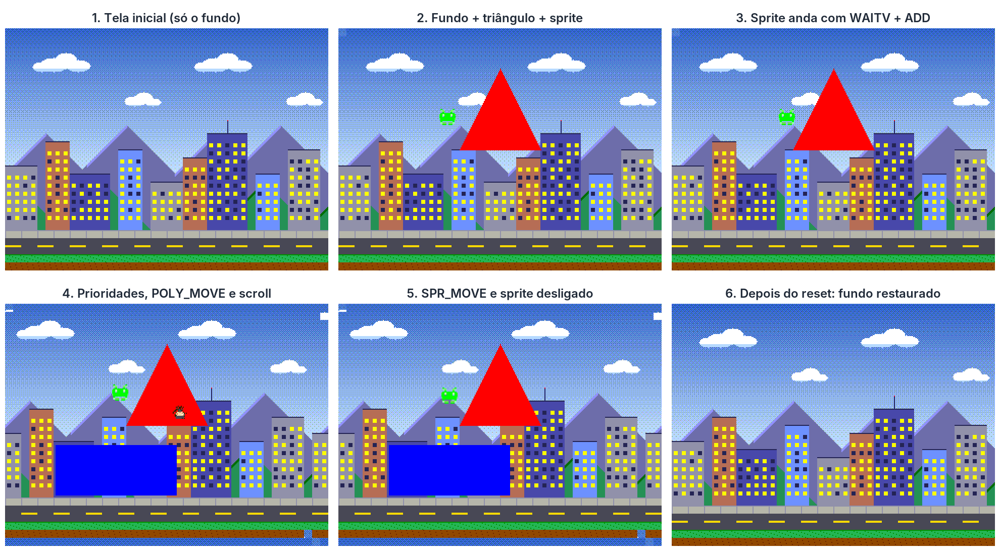
</p>
<p align="center"><em>Figura 7 – Os seis quadros VGA capturados pelo <code>tb_coprocessador_top</code>, todos idênticos pixel a pixel ao modelo de referência.</em></p>

O `tb_programa_arm` verifica a demonstração em Assembly ARM. Ele envia ao RTL a sequência de instruções que o `demo_arm.s` entrega pelo driver e captura a tela em quatro momentos da animação. Entre um momento e outro, dá para ver o scroll do fundo, o retângulo azul descendo e os dois sprites se movendo.

<p align="center">
  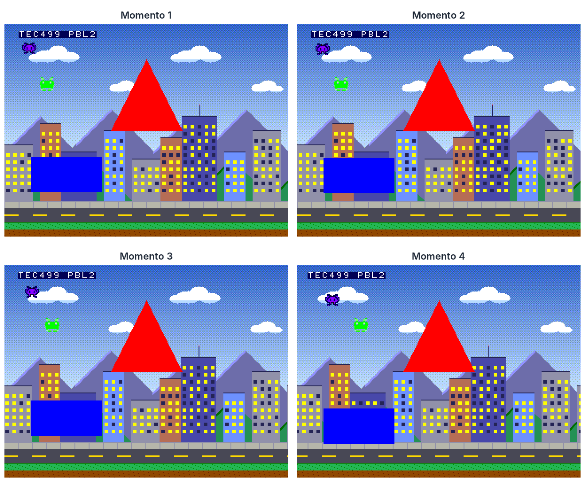
</p>
<p align="center"><em>Figura 8 – Quatro momentos da demonstração em Assembly ARM, capturados pelo <code>tb_programa_arm</code>.</em></p>

### 11.2. Demonstração em bancada

A demonstração na placa foi feita com o **menu interativo** (`sudo ./menu`), que permite testar cada grupo de instruções da ISA e observar o resultado no monitor:

| Opção | Função | O que permite verificar |
|---|---|---|
| 1 — Fundo | trocar um tile, alterar o scroll | `SET_TILE`, `SET_SCROLL` e a repetição do fundo |
| 2 — Polígonos | desenhar triângulo ou retângulo, mover, desligar (slots 0 a 3) | rasterizadores e prioridade entre slots |
| 3 — Sprites | posição, desenho (0 a 31), espelhos, prioridade (BACK), mover, animar | atributos, transparência e sobreposição |
| 4 — Reiniciar | reset do coprocessador | restauração do fundo original |
| 5 — Instrução em hexadecimal | envia qualquer palavra de 32 bits | a ISA "crua"; `F8000000` liga o bit `err` |
| 6 — Busca assíncrona | 8 sprites + 4 polígonos e uma rajada de 786 instruções; depois a cena fica em movimento até apertar Enter | a fila enchendo, o ARM esperando com a fila cheia e o coprocessador esvaziando a fila sozinho |

Durante os testes, os LEDs e displays da placa mostram em tempo real o status e a instrução em execução.

A demonstração em Assembly ARM (`demo_arm.s`, com o programa da ISA `demo.asm`) não chegou a ser apresentada na bancada. Ela foi verificada em simulação pelo `tb_programa_arm` (Figura 8), e as instruções de compilação e execução na placa estão na seção 10.3.

---

## 12. Vídeos de demonstração

### 12.1. Loop de instruções

O vídeo abaixo foi gravado na bancada, com a DE1-SoC ligada ao monitor pela saída VGA. Ele mostra um loop de instruções sendo enviado pelo ARM ao coprocessador. O objetivo é apenas mostrar que as instruções estavam chegando e sendo executadas corretamente: os sprites e o retângulo azul se movem pela tela, junto com o triângulo vermelho desenhado pelo rasterizador.

<p align="center">
  <a href="videos/demonstracao_placa.mp4">
    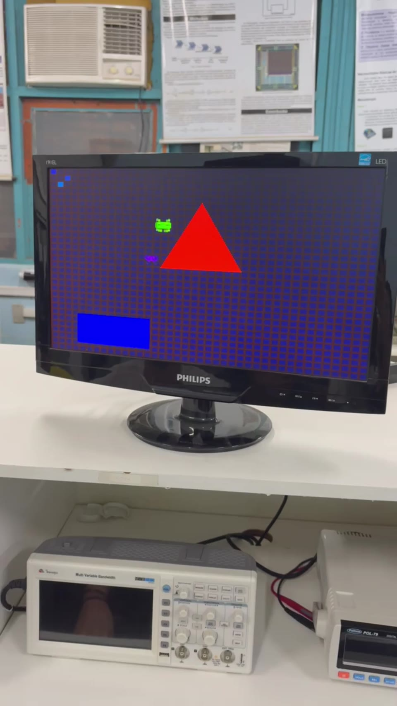
  </a>
</p>
<p align="center"><em>Clique na imagem para abrir o vídeo (<code>videos/demonstracao_placa.mp4</code>).</em></p>

### 12.2. Sprites e polígonos em movimento

Cena com um triângulo e um retângulo nos slots de polígono e dois sprites. Os sprites mudam de posição a cada quadro e passam pela frente do triângulo, mostrando a prioridade entre as camadas.

<p align="center">
  <a href="videos/demonstracao_2.mp4">
    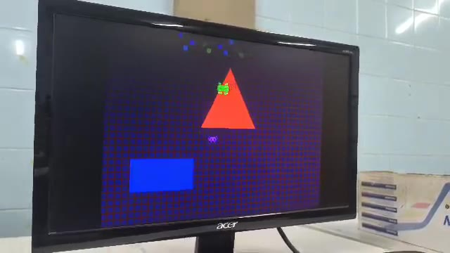
  </a>
</p>
<p align="center"><em>Clique na imagem para abrir o vídeo (<code>videos/demonstracao_2.mp4</code>).</em></p>

### 12.3. Triângulo retângulo e animação

Outra versão da cena, com o triângulo desenhado como triângulo retângulo. Os sprites e o retângulo azul continuam se movendo sobre o fundo.

<p align="center">
  <a href="videos/demonstracao_3.mp4">
    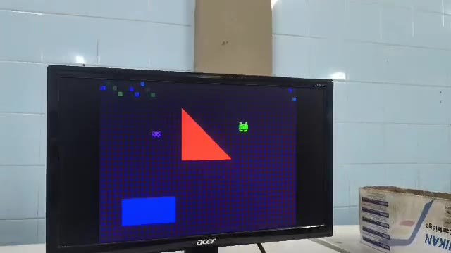
  </a>
</p>
<p align="center"><em>Clique na imagem para abrir o vídeo (<code>videos/demonstracao_3.mp4</code>).</em></p>

### 12.4. Animação contínua

A cena com o triângulo retângulo em funcionamento por mais tempo: os sprites e o retângulo azul seguem em movimento, passando pela frente e ao redor dos polígonos.

<p align="center">
  <a href="videos/demonstracao_4.mp4">
    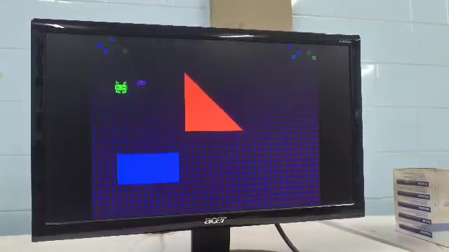
  </a>
</p>
<p align="center"><em>Clique na imagem para abrir o vídeo (<code>videos/demonstracao_4.mp4</code>).</em></p>

---

## 13. Referências

Patterson, D. A., & Hennessy, J. L. (2018). *Computer Organization and Design*. Cambridge, MA: Morgan Kaufmann Publishers.

Terasic. *DE1-SoC User Manual*.

Intel. *Cyclone V Hard Processor System Technical Reference Manual*.

Intel. *Embedded Peripherals IP User Guide* (Avalon PIO Core).
